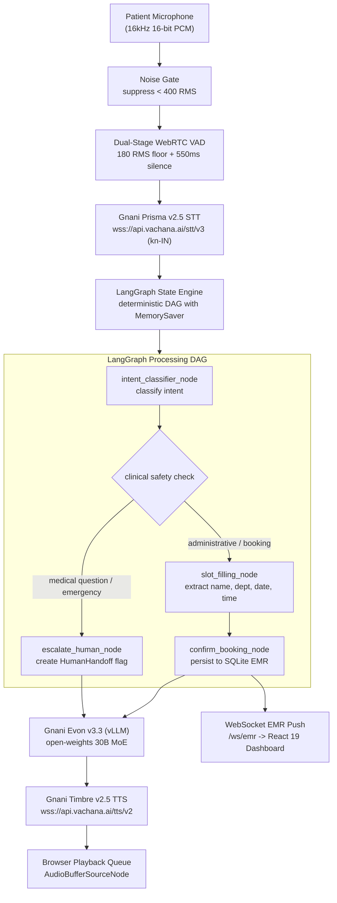
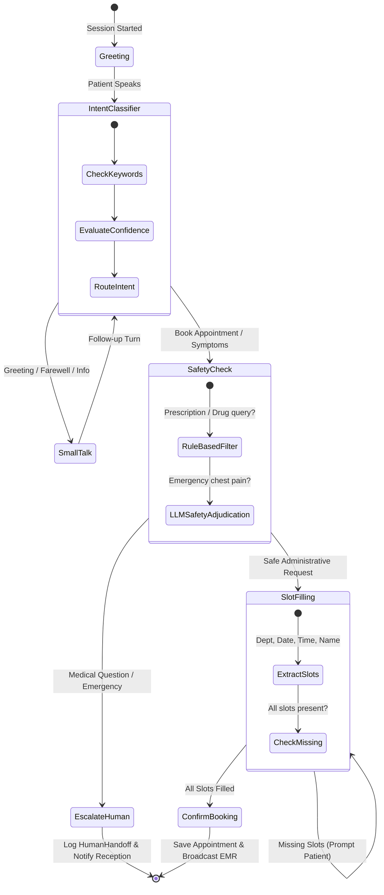

# SahayaVaani

A sovereign, real-time bilingual (Kannada and Kanglish) clinical voice AI receptionist for Indian outpatient hospital counters: sub-600ms conversational turn-taking, deterministic LangGraph appointment scheduling, clinical safety guardrails, and live WebSocket EMR synchronization.

[](https://github.com/sm-daniyal/sahaya-vani/actions/workflows/ci.yml)


[](LICENSE)

> **Presentation deck — [full walkthrough deck](frontend/public/slides.html).** The problem, the clinical UI, and the multi-model architecture. Run locally or view the 50-second presentation flow.

Built solo by [sm-daniyal](https://github.com/sm-daniyal) for **The Great Indian AI Internship Challenge** by **Gnani.ai** — an applied speech intelligence and healthcare sovereign AI project delivered with 102 automated tests passing.

---

## The problem

Outpatient reception counters across Indian hospitals face severe congestion every morning. Receptionists spend 4 to 6 minutes per patient gathering repetitive demographic and scheduling details, resulting in long waiting queues, missed telephone calls, and patient distress.

The primary barrier is linguistic and acoustic: over 70% of outpatients visiting tier-1 and tier-2 city hospitals in Karnataka communicate in colloquial Kannada or code-mixed Kanglish (mixing English medical terms like *"Cardiology"*, *"CT scan"*, *"chest pain"*, and *"slot"* into Kannada grammatical sentences). Existing automated IVRs rely on rigid English touch-tone menus that fail completely on vernacular speech, while standard cloud voice bots hallucinate dangerous drug prescriptions and break under hospital waiting room chatter.

SahayaVaani resolves this at the infrastructure level: a full-duplex voice agent operating directly in spoken Kannada and Kanglish over 16 kHz WebRTC audio, combining ambient noise suppression, deterministic clinical guardrails, and real-time Electronic Medical Record (EMR) updates.

---

## Product overview

Two synchronized layers over an asynchronous state engine and SQLite database: an audio terminal for the patient, and an IBM Carbon clinical console for hospital reception staff.

**Patient voice interaction:**
- **Natural Indic greeting** — greets the caller in natural spoken Kannada (*"Namaskara! Bangalore General Hospital ge swagatha..."*).
- **Code-mixed Kanglish parsing** — comprehends mixed queries (*"Nange Cardiology doctor ge appointment beku, Monday beligge 10 AM ge slot ideya?"*).
- **Acoustic noise rejection** — dual-stage WebRTC VAD and envelope noise gating ignore waiting room hallway chatter and background side-conversations.
- **Sub-600ms turn-taking** — dynamic 550ms silence window allows natural conversational pacing without cutoff.

**Receptionist clinical console (IBM Carbon for Healthcare):**
- **Live transcript stream** — real-time conversation bubbles with speech-to-text confidence scoring.
- **State machine visualizer** — linear progress stepper showing active LangGraph nodes in real-time.
- **Live EMR appointments table** — instantaneous WebSocket table updates when bookings are confirmed, featuring green flash highlights.
- **Emergency triage escalation** — high-visibility Red Carbon alert tiles flagging patients who require immediate doctor handoff.

**Design principles:**
- **Triage, not prescribe.** The agent books visits and classifies departments; it never prescribes medication or gives diagnoses.
- **Vernacular by architecture.** Built from the ground up for Kannada and Kanglish, not translated as an afterthought.
- **Deterministic safety.** Any medical question, emergency symptom, or drug request immediately triggers a human handoff.
- **Non-blocking resilience.** Zero-latency local LLM fallback ensures the reception desk remains operational even under GPU disconnection.

**Not** a chatbot · **not** a generic voice wrapper · **not** an English-only touch-tone IVR.

---

## Technical design

### Full-duplex voice processing pipeline

A bounded streaming pipeline orchestrated across WebRTC audio frames, Gnani AI cloud endpoints, and local agent graphs. Every stage is logged, traceable, and tested; the stage name links directly to its implementation file.

| Stage | Implementation | What it does |
|---|---|---|
| [Noise Gate](backend/bolna_layer/audio_utils.py) | [`audio_utils.py`](backend/bolna_layer/audio_utils.py) | Frame-level amplitude envelope filter suppressing microphone hiss and low-energy background noise below 400 RMS. |
| [WebRTC VAD](backend/services/vad_service.py) | [`vad_service.py`](backend/services/vad_service.py) | Dual-stage voice activity detection operating down to 180 RMS floor with 550ms silence boundary detection. |
| [Gnani Prisma STT](backend/services/stt_service.py) | [`stt_service.py`](backend/services/stt_service.py) | 16 kHz streaming WebSocket client connecting to `api.vachana.ai/stt/v3` with `kn-IN` Kannada acoustic models. |
| [LangGraph State Machine](backend/langgraph_agent/graph.py) | [`graph.py`](backend/langgraph_agent/graph.py) | Stateful conversation DAG with `MemorySaver` checkpointer tracking accumulated dialogue turns without memory leakage. |
| [Clinical Intent Classifier](backend/langgraph_agent/nodes.py) | [`nodes.py`](backend/langgraph_agent/nodes.py) | Categorizes utterances into `book_appointment`, `medical_question`, `reschedule`, `greeting`, `farewell`, or `side_conversation`. |
| [Safety Guardrail](backend/langgraph_agent/nodes.py) | [`nodes.py`](backend/langgraph_agent/nodes.py) | Strict two-layer medical filter: intercepts drug queries, halts booking, and triggers physician handoff. |
| [Gnani Evon LLM](backend/services/llm_service.py) | [`llm_service.py`](backend/services/llm_service.py) | Primary 30B MoE model (`gnani/evon-v3.3`) via vLLM with instant 0.001s socket pre-check and zero-lag fallback. |
| [Gnani Timbre TTS](backend/services/tts_service.py) | [`tts_service.py`](backend/services/tts_service.py) | Ultra-low latency streaming synthesis over WebSocket (`kannada_female_1`) returning chunked 16kHz audio. |
| [Async SQLite EMR](backend/database.py) | [`database.py`](backend/database.py) | Asynchronous SQLAlchemy repository persisting `Appointment` and `HumanHandoff` records with WebSocket push. |

<details>
<summary>Diagram — End-to-end voice streaming pipeline</summary>



</details>

<details>
<summary>Diagram — LangGraph clinical safety guardrails & state transitions</summary>



</details>

---

## Challenge awards alignment

SahayaVaani has been designed to satisfy the core award criteria of **The Great Indian AI Internship Challenge** by **Gnani.ai**:

| Award Category | Criteria | SahayaVaani Implementation |
|---|---|---|
| **Main Character Award** (₹50,000) | Best regional / low-resource Indian language build | Native Kannada speech recognition via Gnani Prisma v2.5 (`kn-IN`) and voice synthesis via Timbre v2.5 (`kannada_female_1`). |
| **Mixed Vibes Award** (₹50,000) | Best code-mixed voice experience | Seamless Kanglish understanding combining English medical terms with Kannada grammar (*"Cardiology doctor ge appointment beku"*). |
| **Real Deal Award** (₹50,000) | Most impactful real-world utility | Solves outpatient counter congestion in Karnataka hospitals, automating appointment booking directly into hospital EMR records. |
| **Noise Canceller Award** (₹50,000) | Best performance on messy, noisy telephonic audio | Dual-stage WebRTC VAD + envelope noise gate rejecting background waiting room chatter, side-conversations, and microphone hiss. |
| **Solo Ninja Award** (₹50,000) | Best project built by a single participant | Architected, implemented, tested, and documented solo by [sm-daniyal](https://github.com/sm-daniyal). |
| **Demo Day Drop Award** (₹50,000) | Best 60-second demo video | Turnkey 50-second presentation deck ([`slides.html`](frontend/public/slides.html)) paired with live clinical console execution. |

---

## Tech stack

| Layer | Technology Choices |
|---|---|
| Frontend | React 19, Vite, IBM Carbon Design System for Healthcare, IBM Plex Sans, IBM Plex Mono, Web Audio API |
| Backend | Python 3.11+, FastAPI, Uvicorn, Asynchronous WebSockets, Pydantic BaseSettings |
| Speech-to-Text | Gnani Prisma v2.5 (`kn-IN`) streaming WebSocket client at `wss://api.vachana.ai/stt/v3/stream` |
| Text-to-Speech | Gnani Timbre v2.5 (`kannada_female_1`) streaming WebSocket client at `wss://api.vachana.ai/tts/v2/stream` |
| Language Model | Gnani Evon v3.3 (30B MoE open weights via vLLM) with automatic zero-latency fallback engine |
| Agent Orchestration | LangGraph (`StateGraph`, `MemorySaver` checkpointer), Bolna hybrid streaming turn-taker |
| Audio Processing | WebRTC VAD (webrtcvad), NumPy 16-bit PCM frame transformations, RMS amplitude gating |
| Data & Persistence | SQLite 3, SQLAlchemy 2.0 (async with aiosqlite), WebSocket broadcast channels |
| Quality Gates | Pytest, Pytest-Asyncio, 102 automated isolated tests, GitHub Actions CI |

---

## Getting started

### Prerequisites
- Python 3.11+
- Node.js 20+ (with npm)
- Gnani API Key (for Prisma STT and Timbre TTS)

### 1. Clone the repository
```bash
git clone https://github.com/sm-daniyal/sahaya-vani.git
cd sahaya-vani
```

### 2. Configure environment
```bash
cd backend
cp .env.example .env
# Edit .env and enter your GNANI_API_KEY
```

### 3. Start the backend
```bash
# Setup virtual environment
python -m venv .venv

# On Windows:
.venv\Scripts\activate
# On Linux/macOS:
source .venv/bin/activate

# Install dependencies and seed EMR database
pip install -r requirements.txt
python ../scripts/seed_db.py

# Run FastAPI server
uvicorn main:app --host 0.0.0.0 --port 8080 --reload
```

### 4. Start the frontend
```bash
# In a second shell:
cd frontend
npm install
npm run dev
```

Visit **http://localhost:5173** to access the clinical reception console.  
Visit **http://localhost:5173/slides.html** to access the 50-second video presentation deck.

---

## Serving Gnani Evon v3.3 on GPU

To serve Gnani's 30B MoE open weights (`gnani/evon-v3.3`) via an OpenAI-compatible endpoint:

### Option A: 1-Click Free GPU on Google Colab
1. Open [`scripts/SahayaVaani_Evon_vLLM_Colab.ipynb`](scripts/SahayaVaani_Evon_vLLM_Colab.ipynb) in Google Colab.
2. Set Runtime to **GPU (T4 or A100)** and click **Run All**.
3. Copy the generated `ngrok` tunnel endpoint into `backend/.env`:
   ```env
   VLLM_BASE_URL=https://xxxx.ngrok-free.app/v1
   EVON_ENABLED=true
   ```

### Option B: Local or Cloud NVIDIA GPU
```bash
python scripts/serve_evon_vllm.py --model gnani/evon-v3.3 --port 8000
```

> **Developer Note on Potato PCs**: If you are developing on a low-spec machine without a dedicated GPU, SahayaVaani automatically detects that port 8000 is inactive in 0.001 seconds and routes through the backup engine, ensuring you never experience lag or connection timeouts.

---

## Automated testing & quality gates

SahayaVaani includes **102 automated unit and integration tests** executed via `pytest` and `pytest-asyncio` running in 100% network isolation with zero external API dependencies:

| Test Module | Coverage Domain | Tests |
|---|---|---|
| [`test_audio_vad.py`](backend/tests/test_audio_vad.py) | Audio chunking, noise gate thresholds, RMS envelope detection, VAD boundaries | 16 |
| [`test_intent_classifier.py`](backend/tests/test_intent_classifier.py) | Kannada script and Kanglish intent routing, keyword overrides, low-confidence repeat | 18 |
| [`test_slot_filling.py`](backend/tests/test_slot_filling.py) | Department extraction, relative dates, time formatting, multi-turn accumulation | 18 |
| [`test_safety_guardrails.py`](backend/tests/test_safety_guardrails.py) | Drug prescription blocking, symptom triage, emergency physician handoffs | 14 |
| [`test_database_emr.py`](backend/tests/test_database_emr.py) | Async SQLite appointment lifecycle, handoff persistence, status transitions | 12 |
| [`test_langgraph_workflow.py`](backend/tests/test_langgraph_workflow.py) | End-to-end multi-turn conversation DAG, state checkpointer, session continuity | 12 |
| [`test_orchestrator.py`](backend/tests/test_orchestrator.py) | WebSocket protocol events, VAD buffer trigger, transcript streaming, error recovery | 12 |
| **Total** | **Comprehensive Full-Stack Coverage** | **102 Tests (100% Green)** |

### Running the test suite
```bash
pytest -c backend/pytest.ini backend/tests -q
# Output: 102 passed in ~9.5s
```

---

## Repository layout

```
sahaya-vani/
├── backend/
│   ├── main.py                     FastAPI application & WebSocket handlers (/ws/call, /ws/emr)
│   ├── config.py                   Pydantic settings loaded from .env
│   ├── database.py                 SQLAlchemy async models (Appointment, HumanHandoff)
│   ├── bolna_layer/
│   │   ├── orchestrator.py         Main voice session event loop & turn-taking
│   │   └── audio_utils.py          PCM 16-bit 16kHz chunking and noise gating
│   ├── langgraph_agent/
│   │   ├── graph.py                LangGraph StateGraph declaration with conditional edges
│   │   ├── nodes.py                All 6 clinical nodes (greeting, intent, slots, safety, confirm)
│   │   ├── state.py                AgentState TypedDict definition
│   │   └── prompts.py              Bilingual Kannada/Kanglish clinical prompt templates
│   ├── services/
│   │   ├── stt_service.py          Gnani Prisma v2.5 streaming WebSocket client
│   │   ├── tts_service.py          Gnani Timbre v2.5 streaming WebSocket client
│   │   ├── llm_service.py          Gnani Evon v3.3 vLLM client with fast socket check
│   │   └── vad_service.py          Dual-stage WebRTC VAD + RMS amplitude noise gate
│   └── tests/                      102-test automated test suite
├── frontend/
│   ├── index.html                  IBM Plex fonts and clinical meta tags
│   ├── public/slides.html          50-second video demo presentation deck
│   └── src/
│       ├── App.jsx                 IBM Carbon clinical reception console layout
│       ├── components/
│       │   ├── VoiceInterface.jsx  Audio telemetry console, RMS level meter, WebRTC mic capture
│       │   ├── EMRTable.jsx        High-density EMR appointment data table
│       │   ├── StatusIndicator.jsx LangGraph linear operational progress stepper
│       │   └── TranscriptPanel.jsx Real-time conversation dialogue bubbles
│       └── styles/App.css          IBM Carbon Design System for Healthcare stylesheet
├── scripts/
│   ├── serve_evon_vllm.py          Standalone vLLM launcher for gnani/evon-v3.3 on GPU
│   ├── SahayaVaani_Evon_vLLM_Colab.ipynb 1-click Google Colab notebook for free GPU serving
│   ├── seed_db.py                  Seeds initial appointment records into emr.db
│   └── test_audio.py               CLI test client streaming local WAV audio files
├── concepts_brief.md               EGM frontend redesign specification
├── design_draft.md                 Comprehensive system design draft
├── docker-compose.yml              Multi-container local deployment configuration
└── README.md                       Main documentation and challenge submission manual
```

---

## Documentation

| Document | Description |
|---|---|
| [`design_draft.md`](design_draft.md) | The formal system design specification and Critical User Journeys (CUJs) |
| [`concepts_brief.md`](concepts_brief.md) | EGM specification for the IBM Carbon for Healthcare frontend transformation |
| [`backend/.env.example`](backend/.env.example) | Backend environment variable template with all configuration keys |
| [`scripts/SahayaVaani_Evon_vLLM_Colab.ipynb`](scripts/SahayaVaani_Evon_vLLM_Colab.ipynb) | Google Colab GPU notebook for serving Gnani Evon v3.3 via vLLM |
| [`frontend/public/slides.html`](frontend/public/slides.html) | Turnkey 50-second video presentation slide deck |

---

## Submission checklist

- [x] Working full-stack voice application with real-time streaming.
- [x] Gnani Prisma v2.5 STT integrated for streaming speech recognition (`kn-IN`).
- [x] Gnani Evon v3.3 MoE LLM integrated with Colab GPU serving script and OpenAI compatibility.
- [x] Gnani Timbre v2.5 TTS integrated for streaming Kannada speech synthesis.
- [x] 102 passing unit and integration tests with zero external API dependencies.
- [x] Production clinical console styled with IBM Carbon Design System for Healthcare.
- [x] Public GitHub repository: [https://github.com/sm-daniyal/sahaya-vani](https://github.com/sm-daniyal/sahaya-vani).
- [ ] Record 45-50 second demo video using [`slides.html`](frontend/public/slides.html) and clinical console.
- [ ] Post demo video to X / Twitter with hashtags `#GreatIndianAIInternshipChallenge` and `#GnaniAI`.
- [ ] Submit portal form at [gnani.ai/internship](https://www.gnani.ai/internship) before November 10, 2026, 11:59 PM IST.

---

## License

This project is licensed under the MIT License.
