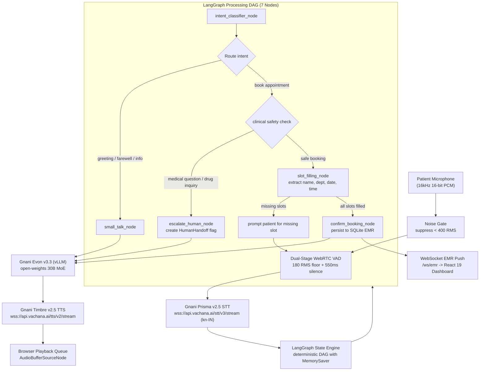
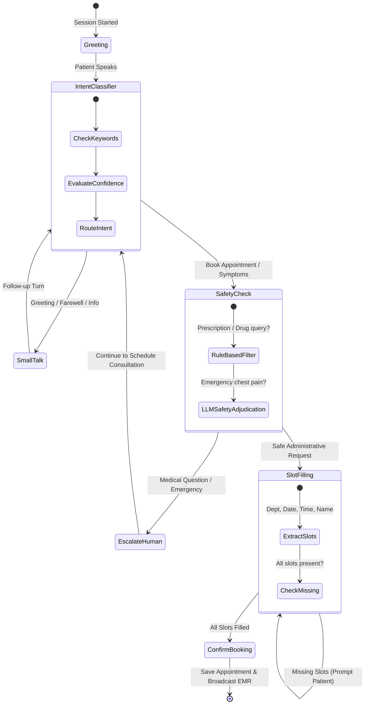

# SahayaVaani

A sovereign, real-time bilingual (Kannada and Kanglish) clinical voice AI receptionist for Indian outpatient hospital counters: sub-600ms conversational turn-taking, deterministic LangGraph appointment scheduling, clinical safety guardrails, and live WebSocket EMR synchronization.

[](https://github.com/sm-daniyal/sahaya-vani/actions/workflows/ci.yml)


[](LICENSE)

> **Presentation deck — [full walkthrough deck](frontend/public/slides.html).** The problem, the clinical UI, and the multi-model architecture. Run locally or view the 45-50 second presentation flow.

Built solo by [sm-daniyal](https://github.com/sm-daniyal) for **The Great Indian AI Internship Challenge** by **Gnani.ai** ([challenge submission manual](SUBMISSION.md)) — an applied speech intelligence and healthcare sovereign AI project delivered with 102 automated tests passing.

---

## The problem

Outpatient reception counters across Indian hospitals face severe congestion every morning. Receptionists spend 4 to 6 minutes per patient gathering repetitive demographic and scheduling details, resulting in long waiting queues, missed telephone calls, and patient distress.

The primary barrier is linguistic and acoustic: over 70% of outpatients visiting tier-1 and tier-2 city hospitals in Karnataka communicate in colloquial Kannada or code-mixed Kanglish (mixing English medical terms like *"Cardiology"*, *"CT scan"*, *"chest pain"*, and *"slot"* into Kannada grammatical sentences). Existing automated Interactive Voice Response (IVR) systems rely on rigid English touch-tone menus that fail completely on vernacular speech, while standard cloud voice bots hallucinate dangerous drug prescriptions and break under hospital waiting room chatter.

SahayaVaani resolves this at the infrastructure level: a full-duplex voice agent operating directly in spoken Kannada and Kanglish over 16 kHz WebRTC audio, combining ambient noise suppression, deterministic clinical guardrails, and real-time Electronic Medical Record (EMR) updates.

---

## Product overview

Two synchronized layers over an asynchronous state engine and SQLite database: an audio terminal for the patient, and an IBM Carbon clinical console for hospital reception staff.

**Patient voice interaction:**
- **Natural Indic greeting** — greets the caller in natural spoken Kannada (*"Namaskara! Bangalore General Hospital ge swagatha..."*).
- **Code-mixed Kanglish parsing** — comprehends mixed queries (*"Nange Cardiology doctor ge appointment beku, Monday beligge 10 AM ge slot ideya?"*).
- **Acoustic noise rejection** — dual-stage WebRTC Voice Activity Detection (VAD) and envelope noise gating ignore waiting room hallway chatter and background side-conversations.
- **Sub-600ms turn-taking** — dynamic 550ms silence window allows natural conversational pacing without cutoff.

**Receptionist clinical console (IBM Carbon for Healthcare):**
- **Live transcript stream** — real-time conversation bubbles with speech-to-text confidence scoring.
- **State machine visualizer** — linear progress stepper showing active LangGraph nodes in real time.
- **Live EMR appointments table** — instantaneous WebSocket table updates when bookings are confirmed, featuring green flash highlights.
- **Emergency triage escalation** — high-visibility Red Carbon alert tiles flagging patients who require immediate doctor handoff.

**Design principles:**
- **Triage, not prescribe.** The agent books visits and classifies departments; it never prescribes medication or gives diagnoses.
- **Vernacular by architecture.** Built from the ground up for Kannada and Kanglish, not translated as an afterthought.
- **Deterministic safety.** Any medical question, emergency symptom, or drug request immediately triggers a human handoff.
- **Resilient fallback.** Automatic socket pre-check routes to an ultra-fast serverless fallback engine if the GPU endpoint is inactive, ensuring zero downtime.

**Not** a chatbot · **not** a generic voice wrapper · **not** an English-only touch-tone IVR.

---

## Technical design

### Voice pipeline (WebRTC, Dual-Stage VAD & Streaming STT)

The audio layer ingests raw 16 kHz, 16-bit mono Pulse Code Modulation (PCM) audio from the patient's browser. Microphone hiss and ambient hospital background chatter below 400 Root Mean Square (RMS) amplitude are filtered by a frame-level noise gate. The cleaned stream enters a dual-stage WebRTC VAD service with a calibrated 550ms silence boundary detector that signals the end of an utterance. Once boundary detection triggers, the speech buffer is streamed to Gnani Prisma v2.5 (`kn-IN`) over persistent WebSockets, returning real-time Indic transcriptions and confidence metrics.

### LangGraph state machine & deterministic clinical safety

Dialogue flow is orchestrated via a deterministic Directed Acyclic Graph (DAG) compiled with LangGraph and backed by a thread-isolated `MemorySaver` checkpointer. Conversation state is preserved across turns without memory leaks. The graph compiles 7 discrete nodes:
1. `greeting_node`: Issues the formal Kannada clinical greeting.
2. `intent_classifier_node`: Analyzes conversation context and classifies intent.
3. `small_talk_node`: Handles vernacular greetings, hospital location inquiries, and polite farewells.
4. `safety_check_node`: Evaluates symptoms vs. medication queries.
5. `slot_filling_node`: Extracts patient name, department, appointment date, and time. If slots are missing, it initiates a single-question reprompt cycle.
6. `confirm_booking_node`: Persists confirmed appointments to SQLite EMR and broadcasts live updates.
7. `escalate_human_node`: Flags medical advice requests, emergency symptoms, or prescriptions for staff handoff while keeping the booking flow accessible.

### Resilient fallback architecture

The primary conversational intelligence is powered by Gnani Evon v3.3 (`gnani/evon-v3.3`), an open-weights 30B Mixture of Experts (MoE) model served via vLLM. To ensure the clinical reception counter never hangs when GPU serving nodes are offline, `EvonLLMService` performs a non-blocking 200ms TCP socket pre-check on initialization. If port 8000 is inactive, traffic is routed immediately to a serverless Gemini Flash fallback via an OpenAI-compatible endpoint, guaranteeing zero connection lag.

### Real-time EMR WebSocket synchronization

The clinical database layer operates asynchronously using SQLAlchemy 2.0 and `aiosqlite`. When `confirm_booking_node` writes an appointment record or `escalate_human_node` logs a triage alert, the backend broadcasts a JSON event over `/ws/emr`. Connected React 19 dashboards receive the event instantly, updating the 48px high-density data table with a temporary 2.5-second highlight.

---

### Pipeline architecture stages

| Stage | What it does |
|---|---|
| [`Noise Gate`](backend/bolna_layer/audio_utils.py) | Frame-level amplitude envelope filter suppressing microphone hiss and low-energy background noise below 400 RMS. |
| [`WebRTC VAD`](backend/services/vad_service.py) | Dual-stage voice activity detection operating down to 180 RMS floor with 550ms silence boundary detection. |
| [`Gnani Prisma STT`](backend/services/stt_service.py) | 16 kHz streaming WebSocket client connecting to `wss://api.vachana.ai/stt/v3/stream` with `kn-IN` Kannada acoustic models. |
| [`LangGraph State Machine`](backend/langgraph_agent/graph.py) | Stateful conversation DAG with `MemorySaver` checkpointer tracking accumulated dialogue turns without memory leakage. |
| [`Clinical Intent Classifier`](backend/langgraph_agent/nodes.py) | Categorizes utterances into `book_appointment`, `medical_question`, `reschedule`, `greeting`, `farewell`, or `other`. |
| [`Safety Guardrail`](backend/langgraph_agent/nodes.py) | Strict two-layer medical filter: intercepts drug queries, halts booking, and triggers physician handoff. |
| [`Gnani Evon LLM`](backend/services/llm_service.py) | Primary 30B MoE model (`gnani/evon-v3.3`) via vLLM with instant 200ms socket pre-check and zero-lag fallback. |
| [`Gnani Timbre TTS`](backend/services/tts_service.py) | Low-latency streaming synthesis over WebSocket (`kannada_female_1`) at `wss://api.vachana.ai/tts/v2/stream`. |
| [`Async SQLite EMR`](backend/database.py) | Asynchronous SQLAlchemy repository persisting `Appointment` and `HumanHandoff` records with WebSocket push. |

<details>
<summary>Diagram — End-to-end voice streaming pipeline</summary>



</details>

<details>
<summary>Diagram — LangGraph clinical safety guardrails & state transitions</summary>



</details>

---

## Challenge awards alignment

SahayaVaani has been designed to satisfy the core award criteria of **The Great Indian AI Internship Challenge** by **Gnani.ai**:

| Award Category | Criteria | SahayaVaani Implementation |
|---|---|---|
| **Main Character Award** (₹50,000) | Best regional / low-resource Indian language build | Native Kannada speech recognition via Gnani Prisma v2.5 (`kn-IN`) and voice synthesis via Timbre v2.5 (`kannada_female_1`). |
| **Mixed Vibes Award** (₹50,000) | Best code-mixed voice experience | Seamless Kanglish understanding combining English medical terms with Kannada grammar (*"Cardiology doctor ge appointment beku"*). |
| **Real Deal Award** (₹50,000) | Most impactful real-world utility | Solves outpatient counter congestion in Karnataka hospitals, automating appointment booking directly into hospital EMR records. |
| **Noise Canceller Award** (₹50,000) | Best performance on messy, noisy telephonic audio | Dual-stage WebRTC VAD + envelope noise gate rejecting background waiting room chatter, side-conversations, and microphone hiss. |
| **Solo Ninja Award** (₹50,000) | Best project built by a single participant | Architected, implemented, tested, and documented solo by [sm-daniyal](https://github.com/sm-daniyal). |
| **Demo Day Drop Award** (₹50,000) | Best 60-second demo video | Turnkey 50-second presentation deck ([`slides.html`](frontend/public/slides.html)) paired with live clinical console execution. |

---

## Tech stack

| Layer | Technology Choices |
|---|---|
| Frontend | React 19, Vite, IBM Carbon Design System for Healthcare, IBM Plex Sans, IBM Plex Mono, Web Audio API |
| Backend | Python 3.11+, FastAPI, Uvicorn, Asynchronous WebSockets, Pydantic BaseSettings |
| Speech-to-Text | Gnani Prisma v2.5 (`kn-IN`) streaming WebSocket client at `wss://api.vachana.ai/stt/v3/stream` |
| Text-to-Speech | Gnani Timbre v2.5 (`kannada_female_1`) streaming WebSocket client at `wss://api.vachana.ai/tts/v2/stream` |
| Primary LLM | Gnani Evon v3.3 (30B MoE open weights via vLLM) served on GPU |
| Fallback LLM | Google Gemini Flash via OpenAI-compatible endpoint with 200ms socket pre-check |
| Agent Orchestration | LangGraph (`StateGraph`, `MemorySaver` checkpointer), Bolna hybrid streaming audio layer |
| Audio Processing | WebRTC VAD (webrtcvad), NumPy 16-bit PCM frame transformations, RMS amplitude gating |
| Data & Persistence | SQLite 3, SQLAlchemy 2.0 (async with aiosqlite), WebSocket broadcast channels |
| Quality Gates | Pytest, Pytest-Asyncio, 102 automated isolated tests, GitHub Actions CI |

---

## Getting started

### Prerequisites
- Python 3.11+
- Node.js 20+ (with npm)
- Gnani API Key (for Prisma STT and Timbre TTS)
- Gemini API Key (optional fallback if running without a local/cloud GPU)

### 1. Clone the repository
```bash
git clone https://github.com/sm-daniyal/sahaya-vani.git
cd sahaya-vani
```

### 2. Configure environment
```bash
cd backend
cp .env.example .env
# Edit .env and enter your GNANI_API_KEY (and optional GEMINI_API_KEY)
```

### 3. Start the backend
```bash
# Setup virtual environment
python -m venv .venv

# On Windows:
.venv\Scripts\activate
# On Linux/macOS:
source .venv/bin/activate

# Install dependencies and seed EMR database
pip install -r requirements.txt
python ../scripts/seed_db.py

# Run FastAPI server
uvicorn main:app --host 0.0.0.0 --port 8080 --reload
```

### 4. Start the frontend
```bash
# In a second shell (from repository root sahaya-vani/):
cd frontend
npm install
npm run dev
```

Visit **http://localhost:5173** to access the clinical reception console.  
Visit **http://localhost:5173/slides.html** to access the 45-50 second video presentation deck.

### Optional: Containerized deployment
```bash
# Run full stack with local vLLM container (requires NVIDIA Container Toolkit):
docker compose up -d
```

---

## Serving Gnani Evon v3.3 on GPU

To serve Gnani's 30B MoE open weights (`gnani/evon-v3.3`) via an OpenAI-compatible endpoint:

### Option A: 1-Click Free GPU on Google Colab
1. Open [`scripts/SahayaVaani_Evon_vLLM_Colab.ipynb`](scripts/SahayaVaani_Evon_vLLM_Colab.ipynb) in Google Colab.
2. Set Runtime to **GPU (T4 or A100)** and click **Run All**.
3. Copy the generated `ngrok` tunnel endpoint into `backend/.env`:
   ```env
   VLLM_BASE_URL=https://xxxx.ngrok-free.app/v1
   EVON_ENABLED=true
   ```

### Option B: Local or Cloud NVIDIA GPU (Linux / WSL2 with CUDA)
```bash
# Ensure vLLM is installed in your GPU environment:
pip install vllm

# Run from repository root:
python scripts/serve_evon_vllm.py --model gnani/evon-v3.3 --port 8000
```

> **Developer Note on Low-Spec Machines**: If developing on a workstation without a dedicated GPU, SahayaVaani's 200ms socket pre-check detects when port 8000 is inactive and automatically routes requests to the cloud fallback engine, avoiding connection lag.

---

## Automated testing & quality gates

SahayaVaani includes **102 automated unit and integration tests** executed via `pytest` and `pytest-asyncio` running in 100% network isolation with zero external API dependencies:

| Test Module | Coverage Domain | Tests |
|---|---|---|
| [`test_audio_vad.py`](backend/tests/test_audio_vad.py) | Audio chunking, noise gate thresholds, RMS envelope detection, VAD boundaries | 16 |
| [`test_intent_classifier.py`](backend/tests/test_intent_classifier.py) | Kannada script and Kanglish intent routing, keyword overrides, low-confidence repeat | 18 |
| [`test_slot_filling.py`](backend/tests/test_slot_filling.py) | Department extraction, relative dates, time formatting, multi-turn accumulation | 18 |
| [`test_safety_guardrails.py`](backend/tests/test_safety_guardrails.py) | Drug prescription blocking, symptom triage, emergency physician handoffs | 14 |
| [`test_database_emr.py`](backend/tests/test_database_emr.py) | Async SQLite appointment lifecycle, handoff persistence, status transitions | 12 |
| [`test_langgraph_workflow.py`](backend/tests/test_langgraph_workflow.py) | End-to-end multi-turn conversation DAG, state checkpointer, session continuity | 12 |
| [`test_orchestrator.py`](backend/tests/test_orchestrator.py) | WebSocket protocol events, VAD buffer trigger, transcript streaming, error recovery | 12 |
| **Total** | **Comprehensive Full-Stack Coverage** | **102 Tests (100% Green)** |

### Running the test suite

```bash
# From repository root:
pytest -c backend/pytest.ini backend/tests -q

# Or directly from backend/:
cd backend && pytest -q
# Output: 102 passed in ~8.99s
```

---

## Repository layout

```text
backend/     Python 3.11+ / FastAPI — voice engine, LangGraph agent, services, SQLite EMR
frontend/    React 19 / Vite — IBM Carbon clinical console & demo presentation deck
scripts/     vLLM GPU launcher, Colab notebook, EMR seeder, audio CLI test client
*.md         System specifications (design_draft.md), briefs (concepts_brief.md), submission checklist (SUBMISSION.md)
```

<details>
<summary>Detailed file tree</summary>

```text
sahaya-vani/
├── backend/
│   ├── main.py                     FastAPI application & WebSocket handlers (/ws/call/{session_id}, /ws/emr)
│   ├── config.py                   Pydantic BaseSettings loaded from .env
│   ├── database.py                 SQLAlchemy async models (Appointment, HumanHandoff)
│   ├── pytest.ini                  Pytest configuration with pythonpath declaration
│   ├── Dockerfile                  Container build file with webrtcvad compilation tools
│   ├── .env.example                Environment variable template with calibrated defaults
│   ├── bolna_layer/
│   │   ├── orchestrator.py         Main voice session event loop & turn-taking
│   │   └── audio_utils.py          PCM 16-bit 16kHz chunking and noise gating
│   ├── langgraph_agent/
│   │   ├── graph.py                LangGraph StateGraph declaration with conditional edges
│   │   ├── nodes.py                All 7 clinical nodes (greeting, intent, small_talk, safety, slots, confirm, escalate)
│   │   ├── state.py                AgentState TypedDict definition
│   │   └── prompts.py              Bilingual Kannada/Kanglish clinical prompt templates
│   ├── services/
│   │   ├── stt_service.py          Gnani Prisma v2.5 streaming WebSocket client
│   │   ├── tts_service.py          Gnani Timbre v2.5 streaming WebSocket client
│   │   ├── llm_service.py          Gnani Evon v3.3 vLLM client with fast socket check
│   │   └── vad_service.py          Dual-stage WebRTC VAD + RMS amplitude noise gate
│   └── tests/                      102-test automated isolated test suite
├── frontend/
│   ├── index.html                  IBM Plex fonts and clinical meta tags
│   ├── package.json                React 19, Vite, IBM Carbon dependencies
│   ├── vite.config.js              Vite build and proxy configuration
│   ├── public/slides.html          45-50 second video demo presentation deck
│   └── src/
│       ├── App.jsx                 IBM Carbon clinical reception console layout
│       ├── components/
│       │   ├── VoiceInterface.jsx  Audio telemetry console, RMS level meter, WebRTC mic capture
│       │   ├── EMRTable.jsx        High-density EMR appointment data table
│       │   ├── StatusIndicator.jsx LangGraph linear operational progress stepper
│       │   ├── TranscriptPanel.jsx Real-time conversation dialogue bubbles
│       │   └── Icons.jsx           IBM Carbon healthcare vector icons (Cross, Calendar, Shield, Bot)
│       └── styles/App.css          IBM Carbon Design System for Healthcare stylesheet
├── scripts/
│   ├── benchmark_vad.py            Automated latency benchmark for noise gating and VAD
│   ├── serve_evon_vllm.py          Standalone vLLM launcher for gnani/evon-v3.3 on GPU
│   ├── SahayaVaani_Evon_vLLM_Colab.ipynb 1-click Google Colab notebook for free GPU serving
│   ├── seed_db.py                  Seeds initial appointment records into emr.db
│   └── test_audio.py               CLI test client streaming local WAV audio files
├── SUBMISSION.md                   Official challenge submission checklist & verification guide
├── concepts_brief.md               Frontend specification for IBM Carbon healthcare theme
├── design_draft.md                 Comprehensive system architecture and CUJ draft
├── docker-compose.yml              Multi-container local deployment configuration
└── README.md                       Main documentation and system overview
```

</details>

---

## Documentation

| Document | Description |
|---|---|
| [`SUBMISSION.md`](SUBMISSION.md) | Challenge deliverables checklist and verification manual |
| [`design_draft.md`](design_draft.md) | The formal system design specification and Critical User Journeys (CUJs) |
| [`concepts_brief.md`](concepts_brief.md) | Specification for the IBM Carbon for Healthcare frontend transformation |
| [`backend/.env.example`](backend/.env.example) | Backend environment variable template with all configuration keys |
| [`scripts/benchmark_vad.py`](scripts/benchmark_vad.py) | Automated p95 audio gating and dual-stage VAD latency benchmark utility |
| [`scripts/SahayaVaani_Evon_vLLM_Colab.ipynb`](scripts/SahayaVaani_Evon_vLLM_Colab.ipynb) | Google Colab GPU notebook for serving Gnani Evon v3.3 via vLLM |
| [`frontend/public/slides.html`](frontend/public/slides.html) | Turnkey 45-50 second video presentation slide deck |

---

## License

This project is licensed under the [MIT License](LICENSE).
