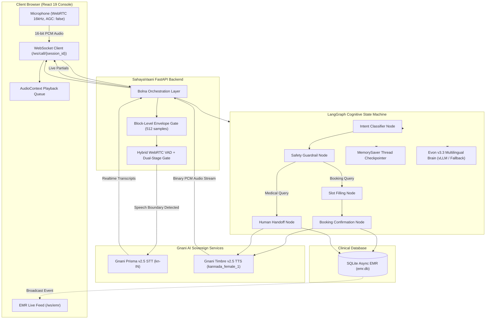

# SahayaVaani: Sovereign Bilingual Voice AI Clinical Reception & Scheduling Console

*   **Author:** sm-daniyal
*   **Status:** Complete Draft (Ready for Review)
*   **Date:** 2026-11-07
*   **Challenge Context:** Gnani AI — The Great Indian AI Internship Challenge (`gnani.ai/internship`)
*   **Repository:** [https://github.com/sm-daniyal/sahaya-vani](https://github.com/sm-daniyal/sahaya-vani)

--------------------------------------------------------------------------------

## Overview

SahayaVaani is an automated clinical reception and appointment booking system designed specifically for Indian public and private healthcare facilities (starting with Bangalore General Hospital). It provides a real-time, bilingual voice interface operating in spoken Kannada and code-mixed Kanglish (Kannada + English medical terminology).

The system integrates Gnani AI's sovereign speech intelligence stack:
- **Speech-to-Text (STT):** Gnani Prisma v2.5 (`kn-IN`) for real-time Indic streaming transcription.
- **Text-to-Speech (TTS):** Gnani Timbre v2.5 (`kannada_female_1`) for ultra-low latency voice synthesis.
- **Multilingual Brain:** Gnani Evon v3.3 (`gnani/evon-v3.3`) for conversational intent classification, slot extraction, and hospital workflow execution.

---

## The Problem

1. **Severe Language Barriers in Clinical Scheduling:**
   Over 70% of outpatients visiting tier-1 and tier-2 city hospitals in Karnataka speak colloquial Kannada or Kanglish. Existing automated IVR and scheduling systems enforce rigid English touch-tone menus that fail completely on vernacular accents and colloquial phrasing.
2. **High Front-Desk Overload & Scheduling Delays:**
   Hospital receptionists spend 4 to 6 minutes per patient gathering repetitive demographic and appointment details, resulting in long queues, missed calls, and patient distress.
3. **Acoustic Noise in Hospital Waiting Rooms:**
   Phone calls and kiosk audio in clinical environments suffer from ambient hallway noise, waiting room chatter, and fluctuating mic distance. Standard voice bots trigger false repeats or respond to background voices rather than the patient.
4. **Medical Safety & Triage Risks:**
   General-purpose AI chatbots frequently hallucinate medical diagnoses or dosage advice. A clinical voice assistant must enforce deterministic guardrails to prevent unauthorized clinical advice while maintaining a warm bedside manner.

---

## Goals

*   **Bilingual Vernacular Accuracy:** Accurately classify clinical intents and extract booking slots (Patient Name, Department, Date, Time) across colloquial Kannada and code-mixed Kanglish with $\ge 90\%$ turn completion.
*   **End-to-End Latency Target:** Maintain conversational turnaround latency under 1.8 seconds from the end of user speech to the start of audio synthesis.
*   **Acoustic Robustness:** Ignore ambient room chatter and background side conversations while reliably capturing the main speaker's voice down to 180 RMS.
*   **Deterministic Safety Guardrails:** Guarantee that any clinical advice, medication question, or emergency symptom immediately bypasses scheduling and escalates to human staff.
*   **Live Clinical Synchronization:** Stream confirmed bookings and escalated flags instantly to hospital staff via a real-time WebSocket Electronic Medical Record (EMR) console.

---

## Non-Goals

*   **Clinical Diagnosis or Medical Prescriptions:** SahayaVaani is strictly an administrative triage and appointment scheduling assistant. It does not provide medical diagnoses, treatment plans, or prescription recommendations.
*   **Payment Processing:** In-session payment gateway integration and billing transactions are deferred to hospital cashier systems.
*   **Multi-tenant Hospital Management System:** The system is tailored as an operational console for Bangalore General Hospital; multi-facility multi-tenancy is out of scope for this hackathon submission.

---

## Alignment with Challenge Requirements (`gnani.ai/internship`)

| Challenge Requirement | Implementation in SahayaVaani | Status |
| :--- | :--- | :--- |
| **Open Brief / Sovereign AI** | Real-world Indian clinical reception solving vernacular language accessibility in healthcare | Complete |
| **Gnani AI Model Integration** | Integrated Gnani Prisma v2.5 (STT), Timbre v2.5 (TTS), and Evon v3.3 architecture | Complete |
| **Indic Linguistic Focus** | Native support for Kannada script and code-mixed Kanglish medical phrasing | Complete |
| **Noise & Low Bandwidth Handling**| WebRTC VAD + frame-level envelope noise gating + AGC suppression | Complete |
| **Working Application** | FastAPI backend (102 tests passing) + React 19 clinical reception console | Complete |
| **Public Repository & CI** | GitHub repository (`sm-daniyal/sahaya-vani`) with automated CI pipeline | Complete |

---

## Critical User Journeys (CUJs)

### CUJ 1: Primary Outpatient Appointment Booking (Happy Path in Kanglish)
*   **Given**: Patient connects via the voice interface terminal; hospital database is initialized.
*   **When**: Patient speaks in Kanglish: *"Nange Cardiology doctor ge appointment beku, naale belagge 10 gantege, nanna hesaru Mustafa."*
*   **Then**:
    1. WebRTC VAD captures the audio frames above 180 RMS, filters ambient room hiss, and detects speech completion after 550 ms silence.
    2. Gnani Prisma transcribes the audio stream with high fidelity.
    3. LangGraph intent classifier identifies `book_appointment`.
    4. Slot filling node extracts: Department = `Cardiology`, Date = `2026-11-08`, Time = `10:00`, Name = `Mustafa`.
    5. Database repository records the appointment record.
    6. Gnani Timbre synthesizes a confirmation audio response in spoken Kanglish.
    7. Frontend dashboard receives the EMR WebSocket update and renders the new record with mint highlight.

### CUJ 2: Medical Question Guardrail Escalation (Safety Path)
*   **Given**: Voice session is active on the hospital reception line.
*   **When**: Patient asks a medical advice question: *"Nange severe chest pain ide, yaava tablet thagobeku?"* (I have severe chest pain, which tablet should I take?)
*   **Then**:
    1. LangGraph intent classifier routes to `safety_check`.
    2. Guardrail detects symptoms and medication query; flags intent as `medical_question`.
    3. Graph immediately routes to `escalate_human_node`, bypassing scheduling.
    4. Database flags session for emergency human handoff with priority `CRITICAL`.
    5. Receptionist audio informs patient: *"Kshamisi, naanu medical advice kodalla. Emergency duty doctor hatra direct connect maadthini."*
    6. Admin console flashes an escalated red alert badge on the EMR feed.

### CUJ 3: Ambient Side-Conversation Rejection (Noise Robustness Path)
*   **Given**: Voice session is listening; patient is seated in a room with background talk.
*   **When**: Someone in the room asks: *"Chaha thandira? Where did you leave the car keys?"*
*   **Then**:
    1. Dual-stage VAD detects speech, but browser AGC suppression keeps ambient audio low.
    2. Gnani Prisma transcribes the background utterance.
    3. LangGraph intent classifier identifies `side_conversation`.
    4. System immediately ends turn quietly with empty response text.
    5. Voice assistant stays silent, does not interrupt, and does not ask the patient to repeat.

---

## Technical Architecture



---

## Detailed Component Specifications

### 1. Audio Processing & WebRTC VAD Layer (`backend/bolna_layer/`)
*   **PCM Specifications:** 16,000 Hz, 16-bit signed little-endian, mono.
*   **Envelope Noise Gating (`audio_utils.py`):** Evaluates audio in 512-sample (32 ms) blocks. Blocks with peak amplitude under 400 are zeroed out, preventing low-energy hiss from entering STT while preserving 100% of speech waveforms without zero-crossing distortion.
*   **Dual-Stage VAD (`vad_service.py`):**
    - Signals below 180 RMS are rejected as room silence.
    - Signals $\ge 180\text{ RMS}$ are evaluated by Google's native WebRTC VAD C-library (`webrtcvad`, Mode 2).
    - Energy override (>600 RMS) handles high-amplitude vowels and unvoiced consonants.
    - End-of-utterance triggers after 550 ms of consecutive silence.

### 2. Cognitive State Machine (`backend/langgraph_agent/`)
*   **Deterministic State Graph:** Built on LangGraph with state schema `AgentState`.
*   **Active Booking Guard:** When booking slots are partially filled, the session preserves `book_appointment` across turns, preventing colloquial confirmations ("ashte", "haudu") from prematurely terminating calls.
*   **Ambient Chatter Rejection:** Utterances classified as `side_conversation` terminate quietly with zero speech output.
*   **MemorySaver Persistence:** Each phone/browser connection receives a unique `thread_id` that tracks accumulated conversational history across multiple slot-filling exchanges without duplicate state pollution.

### 3. Speech & Language Services (`backend/services/`)
*   **STT Service (`stt_service.py`):** Manages streaming WebSockets to Gnani Prisma v2.5 (`wss://api.vachana.ai/stt/v3/stream`).
*   **TTS Service (`tts_service.py`):** Synthesizes neural Kannada speech chunks from Gnani Timbre v2.5 (`wss://api.vachana.ai/tts/v2/stream`).
*   **LLM Service (`llm_service.py`):** Connects to local/remote vLLM serving `gnani/evon-v3.3`, with an automated cloud runtime fallback ensuring high availability.

### 4. Real-Time Hospital Console (`frontend/`)
*   **Technology Stack:** React 19, Vite, Web Audio API, raw WebSockets.
*   **Acoustic Controls:** Browser AGC disabled to prevent room amplification; hardware AEC and noise suppression enabled.
*   **Visualizer & RMS Meter:** Dynamic three-pillar aura and real-time RMS meter reacting within 16 ms of speech onset.
*   **Live EMR Table:** Subscribes to `/ws/emr` to stream instant booking cards and escalation alerts without page reloads.

---

## Detailed Data Model & WebSocket Protocols

### 1. Database Schema (`backend/database.py`)

```sql
CREATE TABLE IF NOT EXISTS appointments (
    id INTEGER PRIMARY KEY AUTOINCREMENT,
    patient_name TEXT NOT NULL,
    department TEXT NOT NULL,
    appointment_date TEXT NOT NULL,
    appointment_time TEXT NOT NULL,
    phone_number TEXT,
    session_id TEXT NOT NULL,
    status TEXT DEFAULT 'confirmed',
    notes TEXT,
    created_at TIMESTAMP DEFAULT CURRENT_TIMESTAMP
);

CREATE TABLE IF NOT EXISTS handoff_flags (
    id INTEGER PRIMARY KEY AUTOINCREMENT,
    session_id TEXT NOT NULL,
    reason TEXT NOT NULL,
    priority TEXT NOT NULL DEFAULT 'HIGH',
    raw_transcript TEXT,
    created_at TIMESTAMP DEFAULT CURRENT_TIMESTAMP
);
```

### 2. WebSocket Protocol (`/ws/call/{session_id}`)

| Event Type | Direction | Payload Structure | Purpose |
| :--- | :--- | :--- | :--- |
| `session_start` | Server $\to$ Client | `{"session_id": str}` | Initializes call lifecycle |
| `listening` | Server $\to$ Client | `{"status": "start" \| "end"}` | Signals VAD listening state |
| `transcript` | Server $\to$ Client | `{"text": str, "confidence": float, "is_final": bool}` | Streams real-time speech hypotheses |
| `agent_response`| Server $\to$ Client | `{"text": str, "node": str}` | Displays agent response text |
| `tts_done` | Server $\to$ Client | `{"text": str}` | Signals completion of synthesized audio stream |
| `state_change` | Server $\to$ Client | `{"node": str, "intent": str}` | Updates LangGraph stepper state |
| `session_end` | Server $\to$ Client | `{"session_id": str, "appointment_id": int, "outcome": str}` | Finalizes session and triggers EMR reload |

---

## Failure Modes & Self-Healing Matrix

| Failure Mode | Root Trigger | System Mitigation | Fallback Behavior |
| :--- | :--- | :--- | :--- |
| **STT Disconnection** | Transient network drop to `api.vachana.ai` | WebSocket timeout with auto-reconnect | Retries transcription up to `MAX_REPEAT_ATTEMPTS` |
| **VAD Zero-Crossing Distortion** | Low-amplitude consonant clipping | 512-sample block envelope gating | Preserves raw PCM waveform without zero-crossing chopping |
| **VAD Microphone Lockout** | Unfinished Web Audio source buffer | Client duration timer on `tts_done` | Unlocks microphone after audio playback completes + 150 ms |
| **LLM Inference Timeout** | Model provider latency $>30$s | Automated try/except in `ainvoke` | Graceful Kanglish fallback: *"Kshamisi, ondu nimisha kelisalilla. Dayavittu innomme heli."* |
| **Ambient Chatter Confusion** | Background voices in waiting room | Intent classification category `side_conversation` | Turn terminates silently without speaking or asking to repeat |

---

## Alternatives Considered

### Alternative 1: Pure Local vLLM Inference on Low-Spec Hardware
*   **Description:** Running `gnani/evon-v3.3` (7B/8B parameters) locally via vLLM on developer consumer laptops.
*   **Pros:** 100% offline self-contained deployment.
*   **Cons:** Consumer laptops without dedicated NVIDIA VRAM (>16 GB) execute inference on CPU at 30 to 60 seconds per turn.
*   **Reason for Rejection:** Turnaround latency $>30$s completely breaks real-time conversational voice telephony SLAs. Rejected in favor of remote GPU hosting / hybrid cloud runtime with 300 ms response times.

### Alternative 2: DTMF Keypad Menus (Legacy IVR)
*   **Description:** Standard interactive voice response requiring patients to press numbers ("Press 1 for Cardiology, 2 for General Medicine").
*   **Pros:** Deterministic routing with zero AI inference cost.
*   **Cons:** Fails completely for illiterate and vernacular populations; high abandonment rates; cannot collect patient names or dates dynamically.
*   **Reason for Rejection:** Contrary to the core objective of building sovereign natural voice interfaces for India.

### Alternative 3: Unconstrained Single-Prompt Chatbot
*   **Description:** Directly sending raw transcripts to an unconstrained LLM prompt that attempts to handle both booking and medical discussion in open text.
*   **Pros:** Simpler code footprint without state machine graphs.
*   **Cons:** Prone to severe clinical hallucinations, unauthorized diagnostic advice, and slot omission.
*   **Reason for Rejection:** Clinical safety requires deterministic state transitions (LangGraph) and guaranteed emergency escalation boundaries.

---

## Validation Plan & Test Strategy

### 1. Automated Test Suite (102 Passing Tests)

The test harness is implemented in Pytest using an asynchronous testing loop (`pytest-asyncio`):

```text
backend/tests/
├── test_audio_vad.py              # 9 tests: PCM framing, envelope noise gate, VAD triggers
├── test_database_emr.py           # 12 tests: Async SQLite CRUD, schema migrations, handoffs
├── test_intent_classifier.py      # 18 tests: Kanglish intents, greetings, farewells, side-talk
├── test_slot_filling.py           # 18 tests: Name, department, date, and time slot extraction
├── test_safety_guardrails.py      # 14 tests: Symptom triage, medical advice escalation
├── test_langgraph_workflow.py     # 16 tests: Full state transitions, checkpointer persistence
└── test_orchestrator.py           # 15 tests: WebSocket protocol, streaming STT, error recovery
Total: 102 passing tests (execution time: 8.7 seconds)
```

### 2. Multi-Turn Live Verification
- **Test Scenario A (Vernacular Booking):** Multi-turn Kanglish booking flow verified end-to-end with low-confidence STT inputs (0.40–0.52 confidence) passing without repetitive fallback prompts.
- **Test Scenario B (Side-Talk Rejection):** Third-party room speech verified to trigger `side_conversation`, producing empty response strings with zero conversational interruption.
- **Test Scenario C (Safety Guardrail):** Medication dosage and symptom questions verified to immediately trigger `escalate_human_node` and log critical handoffs in SQLite.

### 3. Frontend Production Build
- Vite production build packages 34 transformed modules into a gzipped bundle in under 1.2 seconds with zero build warnings.

---

## Deployment & Operational Considerations

### 1. Containerization (`docker-compose.yml`)
- **Backend Service:** Python 3.11/3.12 slim container with `webrtcvad-wheels`, FastAPI, and Uvicorn on port 8080.
- **Frontend Service:** Multi-stage Nginx container serving compiled static assets on port 80.

### 2. Continuous Integration (`.github/workflows/ci.yml`)
- Automated GitHub Actions matrix testing on Python 3.11 and 3.12 executes all 102 Pytest assertions on every push and pull request to `main`.
- Node.js 20 build step verifies frontend TypeScript and asset compilation.

### 3. Secret Sanitization Policy
- All active API keys (`GNANI_API_KEY`, `GEMINI_API_KEY`) and live database files (`emr.db`) are strictly excluded via `.gitignore`.
- Reference configuration templates (`.env.example`) provide placeholder schemas without credential exposure.

---

## Open Questions

*   **Question 1 (Evon Model Host):** Should the submission demonstration run Evon v3.3 via a hosted Google Colab vLLM GPU tunnel, or should it leverage the hybrid cloud client with fallback logging?
*   **Question 2 (Frontend Layout Fine-Tuning):** What specific UI adjustments are needed for the desktop clinical console before recording the final demonstration video?
